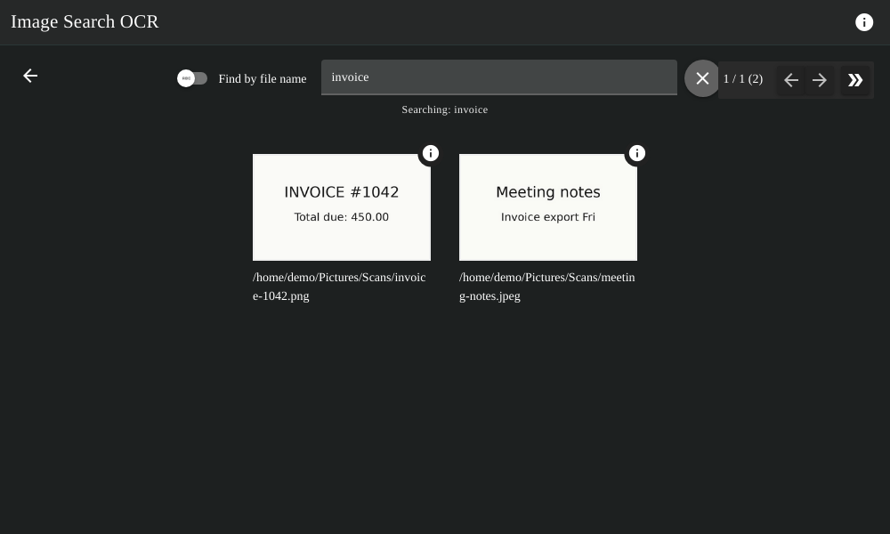
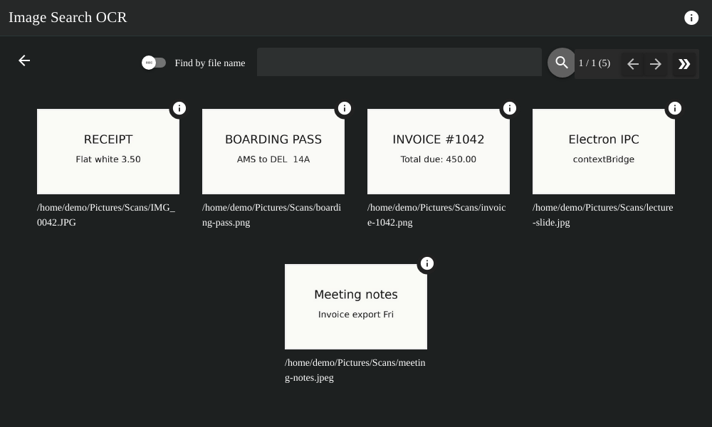
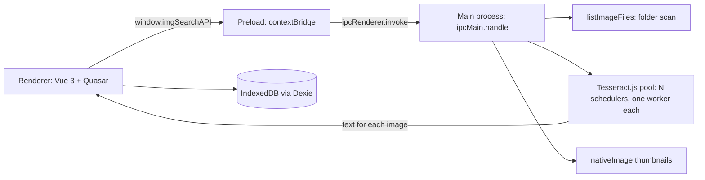

# Image Search OCR

Find images on your computer by the words inside them. Pick one or more folders, the app reads every JPG and PNG with OCR, and then you search that text.

[Get it from the Microsoft Store](https://apps.microsoft.com/detail/9mx9wfk5gcf0)



## Features

- Indexes `.jpg`, `.jpeg` and `.png` files in the folders you pick, in any letter case (`IMG_0042.JPG` counts).
- Runs OCR on your machine with [Tesseract.js](https://github.com/naptha/tesseract.js) and the bundled English language data. Images are never uploaded.
- Runs a pool of OCR workers (4 by default) and lets you add workers while indexing is running.
- Searches by the text in the image or by file name, with paged results and thumbnails.
- Opens a result in your default image viewer and highlights your search term in the recognised text.
- Keeps each indexing run as a saved index that you can rename, reopen or delete.



## How it works



1. The main process shows the folder picker. `listImageFiles` returns the image paths, built with `path.join` so they work on Windows, macOS and Linux.
2. `start-worker` creates the OCR pool: 4 Tesseract schedulers, each with one worker that loads the bundled `eng.traineddata`.
3. The indexing page sends the paths in batches, one image per worker, through `process-img`. The main process recognises a batch in parallel with `Promise.all` and returns the text in the same order.
4. The renderer saves one row per image (index id, path, text, date) to IndexedDB and updates the progress bar after each batch.
5. The search page loads the rows of the chosen index, filters them by text or file name, and pages through the results. Thumbnails come from `nativeImage.createThumbnailFromPath`.

### IPC channels

| Channel | What it does |
| --- | --- |
| `open-folder` | Folder picker, then a list of the image files inside |
| `select-file` | Single image picker |
| `start-worker`, `terminate-worker` | Create or shut down the OCR pool |
| `increase-workers`, `get-number-of-workers` | Grow the pool while it runs and report its size |
| `process-img` | OCR one batch of images, one per worker |
| `get-img`, `get-img-thumbnail`, `open-img` | Read an image, make a thumbnail, open it in the default app |
| `search-text-in-app`, `stop-search-text-in-app` | Highlight text on the page with `findInPage` |

### Security

- `contextIsolation` is on. The renderer has no Node access and can only call the functions on `window.imgSearchAPI`.
- The main process checks every path the renderer sends. `get-img`, `get-img-thumbnail`, `open-img` and `process-img` only accept absolute paths to `.jpg`, `.jpeg` or `.png` files (`isAllowedImagePath`). A compromised renderer can't read other files or launch programs through `shell.openPath`.
- DevTools are closed in production builds.

## Project layout

| Path | Contents |
| --- | --- |
| `src-electron/electron-main.js` | Window, IPC handlers and the OCR worker pool |
| `src-electron/image-files.mjs` | Folder scan and path checks, with no Electron imports so it can be unit tested |
| `src-electron/electron-preload.js` | The `window.imgSearchAPI` bridge |
| `src/pages/filesIndexing.vue` | Indexing screen and batching |
| `src/pages/SearchFromImages.vue` | Search, paging and thumbnails |
| `src/components/SearchHistory.vue` | Saved indexes |
| `test/` | Unit tests and the end-to-end test |

## Develop

```bash
yarn install
yarn dev        # runs the Electron app with hot reload
yarn lint
```

## Test

```bash
yarn test       # unit tests for folder scanning and path checks (Node's test runner)
yarn test:e2e   # builds the app, then drives it with Playwright
```

The end-to-end test launches the built app, stubs the folder picker to point at `test/e2e/fixtures`, indexes the images with the real OCR pool and checks the search results. On Linux, run it on a virtual display with `xvfb-run -a yarn test:e2e`. CI runs lint, the unit tests and the end-to-end test on every push and pull request.

## Build

`yarn build` packages the app with electron-builder. On Windows it produces the AppX package for the Microsoft Store, using the publisher identity in `quasar.config.js`.

macOS packaging isn't set up yet. It needs a `mac` target in the electron-builder config, a Developer ID certificate for signing, and notarization with Apple's notary service.

## Known limitations

- The folder scan doesn't go into subfolders.
- OCR is English only.
- Search loads all rows of an index into memory and does a substring match. There's no full-text index yet.
- Tesseract.js caches the language data in the current working directory. Moving that cache to `app.getPath("userData")` is on the list.

## Roadmap

- Native OCR through a native module (Apple Vision on macOS, `Windows.Media.Ocr` on Windows), benchmarked against Tesseract.js.
- A signed and notarized macOS build, with auto-update for copies installed outside the Store.
- Recursive folder scan and a full-text index.
